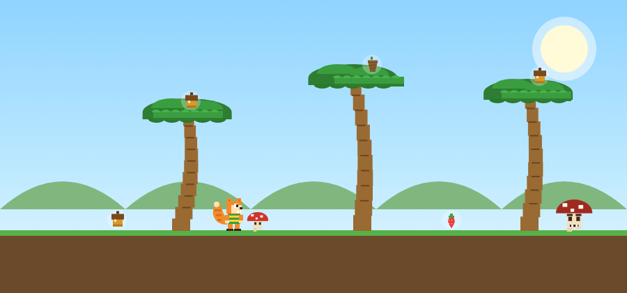
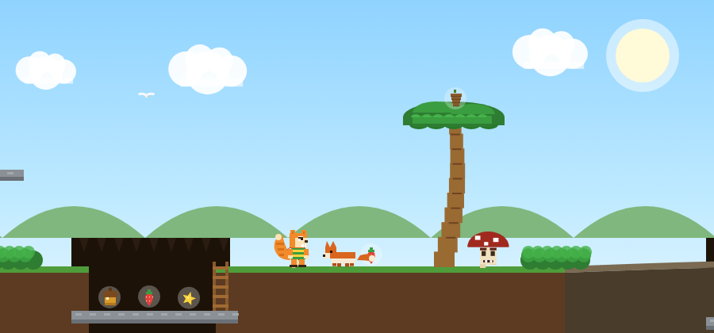

# 🐿️ Eddy a Punta Ala

Un platform 2D in stile pixel-art con **Eddy**, lo scoiattolo mascotte del
campeggio **Punta Ala**. Attraversa pineta, dune, grotte e macchia
mediterranea raccogliendo tesori, saltando sui funghi e sfuggendo alle volpi!

Gioco browser-based (HTML + CSS + JavaScript), **senza dipendenze**: nessun
Node.js, nessuna libreria, tutta la grafica è disegnata su canvas.

## 🎬 Gioca online

👉 **[Gioca subito su GitHub Pages](https://giovannitognoloni.github.io/eddy-puntala/)**

## 📸 Screenshot

### Livello 1 — Pineta → Mare


### Livello 2 — Macchia Mediterranea (volpi, grotte, power-up)


## ▶️ Come giocare

Apri **`index.html`** con un doppio clic (funziona in qualsiasi browser
moderno: Chrome, Edge, Firefox…). Nessuna installazione richiesta.

Oppure, da riga di comando:

```bash
# un qualsiasi server statico, ad es.:
python -m http.server
# poi apri http://localhost:8000
```

## 🎮 Comandi

| Tasto | Azione |
|-------|--------|
| `←` `→` o `A` `D` | Muoviti |
| `SPAZIO` / `↑` | Salta (tieni premuto per saltare più in alto) |
| `↓` | Caduta veloce / abbassati |
| `↑` / `↓` | Arrampicati su pini e scale · nasconditi nei cespugli |
| `1` / `2` | Scegli il livello dal menu |
| `R` | Ricomincia il livello |
| `ESC` | Torna al menu |
| `M` o 🔊 | Attiva/disattiva l'audio |

## 🗺️ Livelli

### Livello 1 — Pineta → Mare
Attraversa **pineta, dune e spiaggia** fino al mare. Raccogli regali di valore
diverso (🌰 ghianda +100, 🟤 pigna +150, 🍓 fragola +200, ⭐ stella +500),
salta sui funghi (anche quelli **grandi e minacciosi**), arrampicati sui pini
marittimi e trova il **forziere segreto** saltando di chioma in chioma.

### Livello 2 — Macchia Mediterranea
Quattro zone: **Macchia → Grotte → Rocce → Radura**. Novità:

- 🥕 **Verdure power-up** (stile Pac-Man): danno **FORZA!** per pochi secondi
  (salto e corsa potenziati, respingi le volpi). Sono **rare e difficili** da
  raggiungere — in cima a torri di roccia o nascoste sottoterra.
- 🦊 **Volpi inseguitrici**: ti inseguono per un breve periodo. Hanno **inerzia**
  (puoi scavalcarle con un salto) e se **le salti in testa** le stordisci.
- 🕳️ **Passaggi sotterranei**: scendi nelle **grotte** piene di tesori. Le volpi
  si fermano al bordo… ma se resti troppo a lungo **scendono dalla scala** a
  cercarti!
- 🪜 **Scale** per salire e scendere dalle grotte.
- 🫣 **Cespugli-nascondiglio**: resta fermo dentro un cespuglio per sparire
  alla vista delle volpi.

## ✨ Caratteristiche tecniche

- Motore 2D originale con fisica salto (velocità + gravità), collisioni AABB,
  movimento indipendente dal frame-rate (`deltaTime`).
- Pixel-art **procedurale** disegnata su `<canvas>` (nessun asset esterno).
- Audio **sintetizzato** con Web Audio API (effetti stile arcade, nessun file).
- Parallasse (nuvole, colline, mare), particelle, popup punteggio, high-score.

## 📁 Struttura

```
eddy-puntala/
├─ index.html   # pagina, HUD, stile, overlay menu
├─ game.js      # tutto il motore e i due livelli
└─ README.md
```

## 🎨 Crediti

Personaggio **Eddy** — mascotte del campeggio Punta Ala.
Grafica, codice e design del gioco originali.
